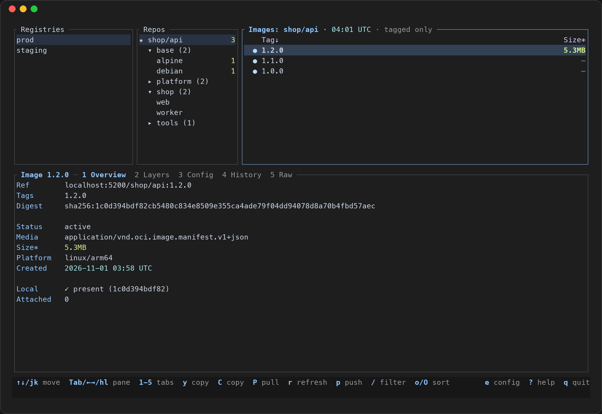
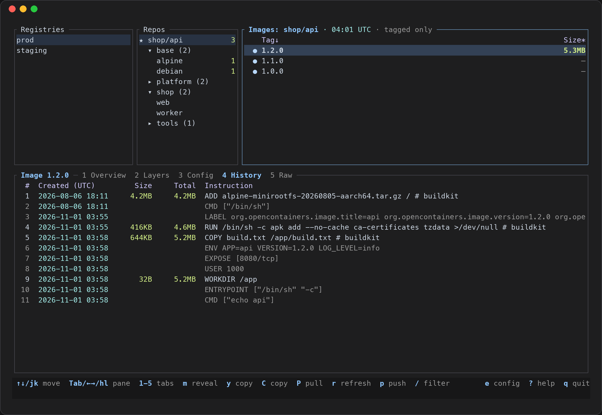
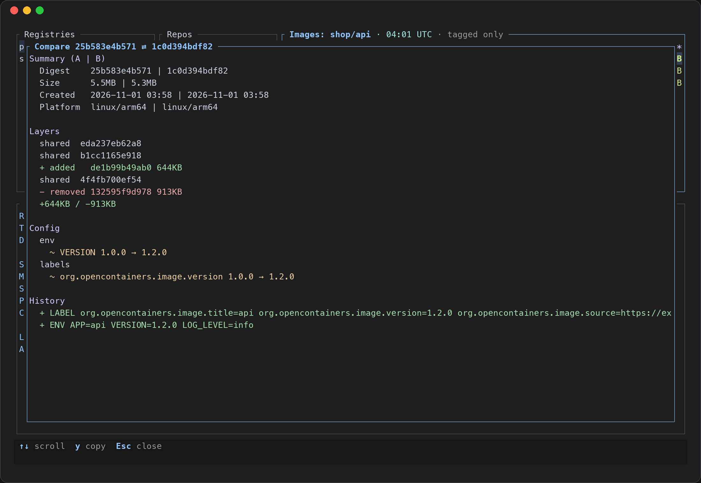
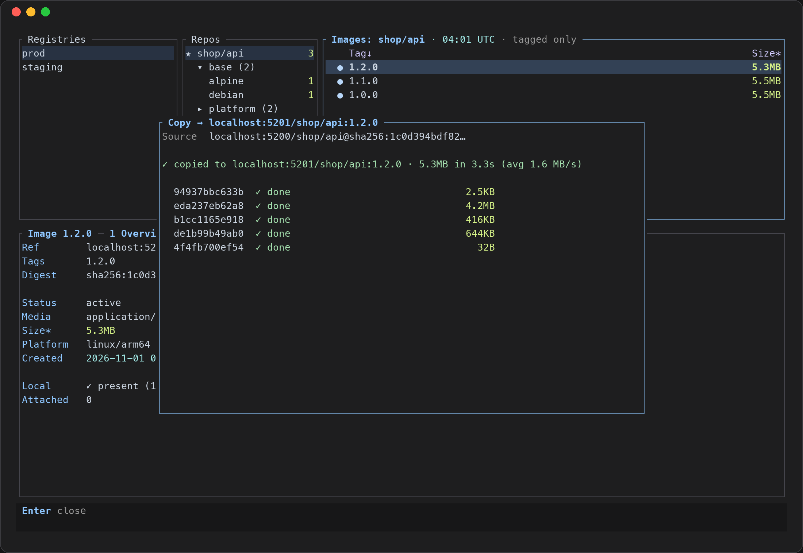
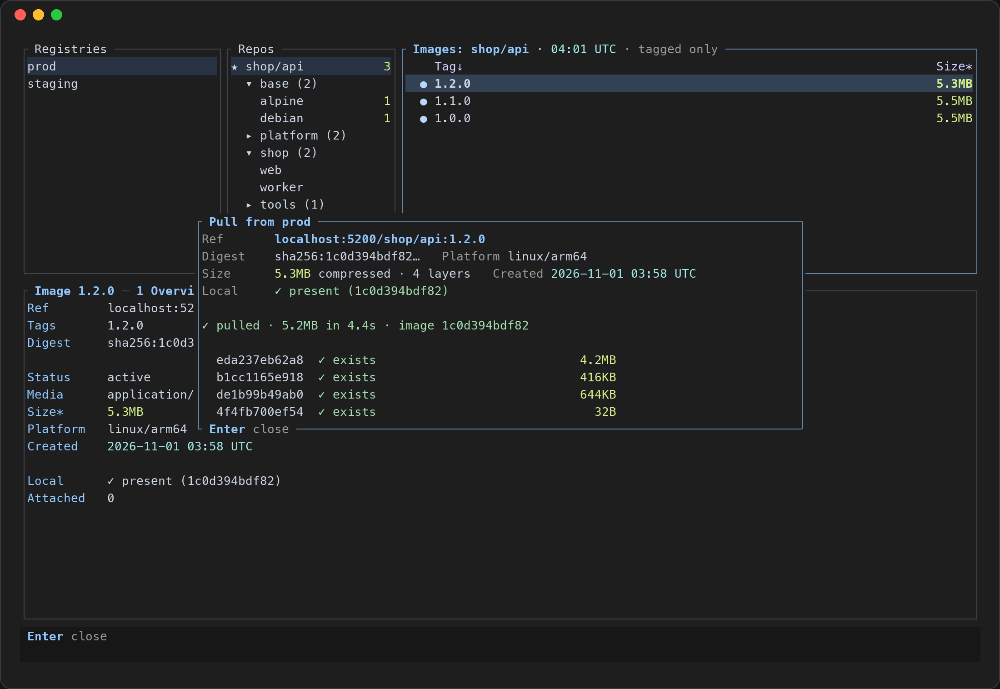
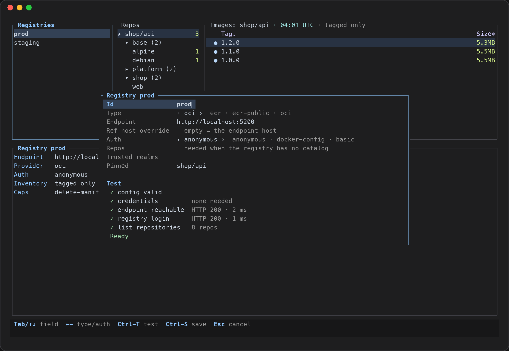
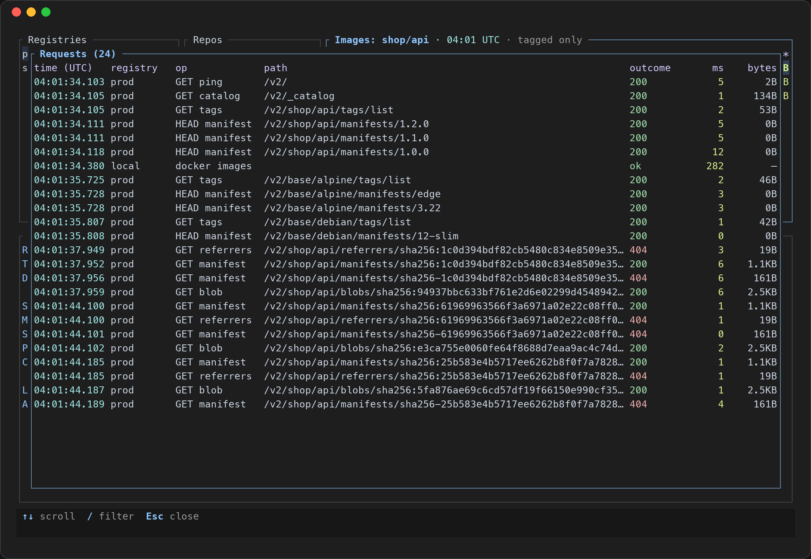

<div align="center">

# LCQuay

**A fast terminal UI for container registries: AWS ECR, ECR Public and any OCI registry.**

Browse repositories and images, inspect manifests, push, pull, copy, export and clean up,
without the console, without `aws ecr` incantations, without leaving the terminal.

[](https://github.com/lyokha113/lcquay/actions/workflows/ci.yml)
[](https://github.com/lyokha113/lcquay/releases)
[](#license)




</div>

---

## Contents

- [Why](#why)
- [Features](#features)
- [Screenshots](#screenshots)
- [Installation](#installation)
- [Quick start](#quick-start)
- [Configuration](#configuration)
- [Key bindings](#key-bindings)
- [Authentication and security](#authentication-and-security)
- [Building from source](#building-from-source)
- [Testing](#testing)
- [Troubleshooting](#troubleshooting)
- [Contributing](#contributing)
- [License](#license)

## Why

Container images end up spread across several registries: a private ECR per account, an
ECR Public gallery, a self-hosted Harbor or `registry:2`. Answering simple questions such as
*"which tag is on this digest?"*, *"what changed between 1.1 and 1.2?"* or *"is this image
already pulled?"* usually means switching between the AWS console, `aws ecr`, `docker` and
`curl`. LCQuay puts all of them behind one keyboard-driven screen, and it is careful by default:
destructive actions are previewed and confirmed, writes are never retried blindly, and secrets
never reach the screen or the logs.

## Features

**Browse**
- One screen for every registry: **AWS ECR**, **ECR Public** and **OCI / Docker registries**
  (`registry:2`, Harbor, GHCR, …).
- Namespace **tree** for repositories (`team/service/app`), collapsible with `←` / `→`.
- **Pinned** repositories shown first (★), with their image counts loaded in the background.
- Image list with tags, push time, compressed size, last pull time (ECR) and a `●` marker for
  images already present in local Docker.
- Detail tabs: **Overview**, **Layers**, **Config** (env, labels, entrypoint; secrets masked),
  Dockerfile-style **History** with per-step sizes, and the **Raw** manifest JSON.
- Multi-platform images: switch platform with `[` / `]`.
- **Referrers** (cosign signatures, SBOMs, attestations) listed on the Overview tab.
- Filter (`/`) and sort (`o` / `O`) any list.

**Act**
- **Push** a local image with a guided wizard that shows the full target reference and warns
  before moving an existing tag.
- **Pull** into local Docker with live per-layer progress, speed and ETA; hide it and keep browsing.
- **Copy / retag** an image to another repository or registry, registry to registry, without
  going through local Docker: blobs that already exist are skipped, cross-repository mounts are
  used when possible, multi-platform indexes are copied whole and the result digest is verified.
- **Export** to an OCI layout tarball that loads with `docker load`, for one platform or all.
- **Compare** two images (`=`): size, layers added or removed, config and history changes.
- **Delete** with a preview: range marks (`v`), glob marks (`a`), untagged sweeps, whole-manifest
  deletes, and a typed confirmation. A dependency check keeps you from orphaning index children.
- `docker login` for ECR, ECR Public and basic-auth registries in one key (`L`).

**Manage**
- Edit, add and remove registries **inside the app** (`c` / `n` / `x`), with a one-key
  **connection test** (`Ctrl-T`) that checks config, credentials, reachability, login and listing.
  Comments and formatting in `config.toml` are preserved.
- **Request log** (`!`): every registry, AWS and Docker call with status, timing and size, with
  no tokens and no query strings.
- Four colour themes, including variants that keep your terminal's own background.

## Screenshots

| Dockerfile-style history | Compare two images |
|---|---|
|  |  |
| **Copy between registries** | **Pull with live progress** |
|  |  |
| **Registry editor + connection test** | **Request log** |
|  |  |

## Installation

Pre-built binaries are attached to every [GitHub release](https://github.com/lyokha113/lcquay/releases).

### macOS (Apple Silicon and Intel)

```sh
# Apple Silicon; use x86_64-apple-darwin on Intel Macs
VERSION=v0.1.1
curl -LO https://github.com/lyokha113/lcquay/releases/download/$VERSION/lcquay-$VERSION-aarch64-apple-darwin.tar.gz
tar xzf lcquay-$VERSION-aarch64-apple-darwin.tar.gz
sudo install lcquay-$VERSION-aarch64-apple-darwin/lcquay /usr/local/bin/
```

The binary is not notarized. If macOS blocks it, run
`xattr -d com.apple.quarantine /usr/local/bin/lcquay`.

### Ubuntu / Debian (amd64)

```sh
VERSION=0.1.1
curl -LO https://github.com/lyokha113/lcquay/releases/download/v$VERSION/lcquay_${VERSION}-1_amd64.deb
sudo apt install ./lcquay_${VERSION}-1_amd64.deb
```

### Arch Linux (x86_64)

Each release ships a `PKGBUILD` for the pre-built binary:

```sh
mkdir lcquay-bin && cd lcquay-bin
curl -LO https://github.com/lyokha113/lcquay/releases/latest/download/PKGBUILD
makepkg -si
```

### Other Linux (x86_64)

Download `lcquay-<version>-x86_64-unknown-linux-gnu.tar.gz` from the release page and put the
`lcquay` binary on your `PATH`.

### From source

See [Building from source](#building-from-source), or with a Rust toolchain:

```sh
cargo install --git https://github.com/lyokha113/lcquay --locked
```

### Requirements

- A terminal with 24-bit colour and at least 100×30 cells.
- Docker (Docker Desktop, OrbStack, Colima or the Linux daemon) for push, pull, login and the
  local-image marker. Browsing, copy, export and delete do not need Docker.
- For AWS registries: credentials the AWS SDK can find (environment, `~/.aws` profiles, SSO,
  instance or container roles).

## Quick start

```sh
lcquay
```

The first run writes a commented example to `~/.config/lcquay/config.toml`. Press `e` to edit
it in `$VISUAL` / `$EDITOR`, or press `n` on the Registries pane to add a registry from a form,
then `Ctrl-T` to test it and `Ctrl-S` to save.

Navigate with `↑↓` / `jk`, switch panes with `Tab` or `←→` / `hl`, open with `Enter`,
press `?` for every key and `q` to quit.

To try it without any cloud account:

```sh
docker run -d --name registry -p 127.0.0.1:5000:5000 registry:2
docker pull alpine && docker tag alpine localhost:5000/demo/alpine:1 && docker push localhost:5000/demo/alpine:1
```

and add this registry to the config:

```toml
[[registries]]
id = "local"
provider = { type = "oci" }
endpoint = "http://localhost:5000"
auth = { type = "anonymous" }
```

## Configuration

| What | Location |
|---|---|
| Config | `$XDG_CONFIG_HOME/lcquay/config.toml` (default `~/.config/lcquay/config.toml`) |
| Theme | `$XDG_STATE_HOME/lcquay/theme` (default `~/.local/state/lcquay/theme`), chosen in-app with `t` |
| Log | `$XDG_STATE_HOME/lcquay/lcquay.log`; level via `LCQUAY_LOG=error\|warn\|info\|debug\|trace\|off` |
| Docker credentials | `$DOCKER_CONFIG/config.json` (default `~/.docker/config.json`), read only |

The file is a list of registries:

```toml
schema_version = 1

# AWS ECR (private). The endpoint is derived from account and region.
[[registries]]
id = "prod"
provider = { type = "ecr", account_id = "123456789012", region = "us-east-1", profile = "work" }
pinned = ["team/api", "team/web"]       # optional: shown first (★)

# AWS ECR Public. Repository paths are <alias>/<repo>.
[[registries]]
id = "public"
provider = { type = "ecr-public", alias = "myalias" }

# Any OCI / Docker registry without auth.
[[registries]]
id = "local"
provider = { type = "oci" }
endpoint = "http://localhost:5000"
repositories = ["team/api"]             # used when the registry has no _catalog
auth = { type = "anonymous" }

# A registry that uses the credentials from `docker login`.
[[registries]]
id = "harbor"
provider = { type = "oci" }
endpoint = "https://harbor.example.com"
ref_host = "harbor.example.com"          # host used in image references (default: endpoint host)
trusted_realms = ["auth.example.com"]    # extra Bearer realm hosts allowed to receive credentials
auth = { type = "docker-config" }

# Basic auth. The password is read from an environment variable and never stored in the file.
[[registries]]
id = "ci"
provider = { type = "oci" }
endpoint = "https://registry.example.com"
auth = { type = "basic", username = "ci", password_env = "REGISTRY_PASSWORD" }
```

| Key | Applies to | Meaning |
|---|---|---|
| `id` | all | Unique name shown in the Registries pane. |
| `provider.type` | all | `ecr`, `ecr-public` or `oci`. |
| `provider.account_id`, `provider.region` | `ecr` | AWS account and region. |
| `provider.alias` | `ecr-public` | Your ECR Public alias. |
| `provider.profile` | `ecr`, `ecr-public` | AWS profile; empty means the default credential chain. |
| `endpoint` | `oci` (optional override for ECR) | Registry base URL, `http://` or `https://`. |
| `ref_host` | all, optional | Host written in image references, if it differs from the endpoint. |
| `auth` | `oci` | `anonymous`, `docker-config`, or `basic` with `username` + `password_env`. |
| `repositories` | `oci`, optional | Repositories to list when `/v2/_catalog` is unavailable (GHCR, Docker Hub…). |
| `trusted_realms` | `oci`, optional | Extra token-service hosts allowed to receive credentials. |
| `pinned` | all, optional | Repositories shown first, prefetched in the background. |

The in-app editor (`c` / `n` / `x`) writes the same file and keeps your comments and ordering.

## Key bindings

Press `?` inside the app for the full list. The most used keys:

| Key | Action |
|---|---|
| `↑↓` `j k` | Move |
| `Tab` `←→` `h l` | Switch pane; on a repository group `←` / `→` fold and unfold it |
| `Enter` | Open |
| `1`–`5` | Detail tabs: Overview, Layers, Config, History, Raw |
| `[` `]` | Previous / next platform of a multi-platform image |
| `/` · `o` `O` | Filter · sort column / reverse |
| `r` | Refresh the focused level |
| `p` · `P` | Push a local image · pull the selected image |
| `C` · `X` | Copy / retag · export to an OCI tarball |
| `=` | Mark a base image; `=` on another compares them |
| `space` `v` `a` `u` | Mark: one image · a range · by glob · untagged |
| `d` | Delete preview for the marks (typed confirmation) |
| `L` | `docker login` to the selected registry |
| `c` `n` `x` | Edit / add / remove a registry (Registries pane) |
| `Ctrl-T` · `Ctrl-S` | Test the connection · save (registry form) |
| `y` · `m` | Copy the reference (or the Raw JSON) · reveal masked values |
| `!` · `t` · `e` | Request log · theme · edit config in `$EDITOR` |
| `?` · `q` · `Ctrl-C` | Help · quit · quit from anywhere |

## Authentication and security

- **ECR / ECR Public** use the AWS SDK credential chain (env, profiles, SSO, roles). LCQuay
  calls `GetAuthorizationToken` itself; it does not shell out to the AWS CLI.
- **OCI registries** support anonymous access, `docker login` credentials (including credential
  helpers such as `osxkeychain` and `pass`) and basic auth from an environment variable.
- Credentials are only sent to the registry's own origin, or to a token realm you trust explicitly.
  Redirects to blob storage (S3, CDNs) never carry them.
- Passwords are never written to the config and never passed on a command line;
  `docker login` receives them on stdin.
- Tokens, `Authorization` headers and URL query strings (signed URLs, upload sessions) are never
  shown, logged or put in the request log.
- Writes (push, copy, delete) are never retried automatically. If a write may have reached the
  registry but its answer was lost, LCQuay says *uncertain* and tells you what to check.
- Masking of env values, labels and commands is best effort, by key name. Do not rely on it when
  sharing your screen.

Minimum IAM permissions for ECR: browsing needs `ecr:DescribeRepositories`, `ecr:DescribeImages`,
`ecr:BatchGetImage`, `ecr:GetDownloadUrlForLayer` and `ecr:GetAuthorizationToken`. Copy and push
also need `ecr:BatchCheckLayerAvailability`, `ecr:InitiateLayerUpload`, `ecr:UploadLayerPart`,
`ecr:CompleteLayerUpload` and `ecr:PutImage`; delete needs `ecr:BatchDeleteImage`.

## Building from source

Requirements: Rust **1.94.1 or newer** (`rustup update stable`), a C toolchain and `cmake`
(the AWS SDK's TLS crate compiles native code).

```sh
git clone https://github.com/lyokha113/lcquay
cd lcquay
cargo build --release --locked
./target/release/lcquay
```

Install into `~/.cargo/bin`:

```sh
cargo install --path . --locked
```

Build a `.deb` locally with [`cargo-deb`](https://github.com/kornelski/cargo-deb):
`cargo install cargo-deb && cargo deb`.

### Project layout

```
src/
  app/        state machine: pure, no I/O, no clock (update + effects)
  ui/         ratatui rendering: pure functions of the state
  tasks.rs    effect runtime: supervised background tasks, cancellation
  registry/   OCI distribution client, copy engine
  providers/  ECR, ECR Public and OCI providers
  auth/       docker config, credential helpers, ECR tokens
  docker/     Docker Engine API (bollard)
  export.rs   OCI layout tarball writer
  config.rs   config file, paths; config_edit.rs writes it back with toml_edit
tests/        integration tests (wiremock); it_live.rs holds opt-in live tests
```

## Testing

```sh
cargo fmt --check
cargo clippy --all-targets -- -D warnings
cargo test
```

The default suite needs no network, Docker or cloud account: HTTP is served by `wiremock`,
AWS calls by `aws-smithy-mocks`, and the UI is checked with `insta` snapshots.

Live tests in `tests/it_live.rs` are ignored by default. They run against real services when
`LCQUAY_IT=1` is set, plus the variables each test names (it fails loudly if one is missing):

```sh
docker run -d --name lcquay-it-registry -p 127.0.0.1:5000:5000 \
  -e REGISTRY_STORAGE_DELETE_ENABLED=true registry:2
LCQUAY_IT=1 LCQUAY_IT_REGISTRY=http://localhost:5000 cargo test --test it_live -- --ignored
```

| Variable | Used by |
|---|---|
| `LCQUAY_IT_REGISTRY`, `LCQUAY_IT_REGISTRY2` | `registry:2` tests (browse, push, delete, copy, export) |
| `LCQUAY_IT_PUSH_IMAGE` | push and copy tests: a local image such as `busybox:1` |
| `LCQUAY_IT_REGISTRY_AUTH` | basic-auth (`htpasswd`) registry test |
| `LCQUAY_IT_ECR_ACCOUNT`, `LCQUAY_IT_ECR_REGION`, `LCQUAY_IT_ECR_REPO` | ECR tests |
| `LCQUAY_IT_ECR_SCRATCH_REPO` | ECR copy test: a throw-away repository; the source repo needs a layer over 10 MiB |
| `LCQUAY_IT_ECR_PUBLIC_ALIAS`, `LCQUAY_IT_ECR_PUBLIC_REPO` | ECR Public tests |

## Troubleshooting

- **"press L to log in" / 401 on an ECR registry**: your AWS credentials expired. Refresh them
  (`aws sso login`, new keys), then press `r`.
- **A registry shows no repositories**: it probably has no `/v2/_catalog` (GHCR, Docker Hub).
  List them in `repositories = [...]`.
- **Garbled borders or colours**: use a terminal with 24-bit colour and a font with box-drawing
  glyphs; set `COLORTERM=truecolor` if your terminal does not.
- **Something looks wrong**: open the request log with `!`, or run with `LCQUAY_LOG=debug` and
  read `~/.local/state/lcquay/lcquay.log`. Neither contains credentials.

## Contributing

Issues and pull requests are welcome. Before opening a PR, run the three commands in
[Testing](#testing). If a UI change updates a snapshot, review the `.snap.new` file and rename
it to `.snap` (or use `cargo insta review`). Please keep `app/` and `ui/` free of I/O, and never
let a secret reach a log line or the screen.

## License

Licensed under either of

- Apache License, Version 2.0 ([LICENSE-APACHE](LICENSE-APACHE))
- MIT license ([LICENSE-MIT](LICENSE-MIT))

at your option.

Unless you explicitly state otherwise, any contribution intentionally submitted for inclusion
in this work by you, as defined in the Apache-2.0 license, shall be dual licensed as above,
without any additional terms or conditions.
